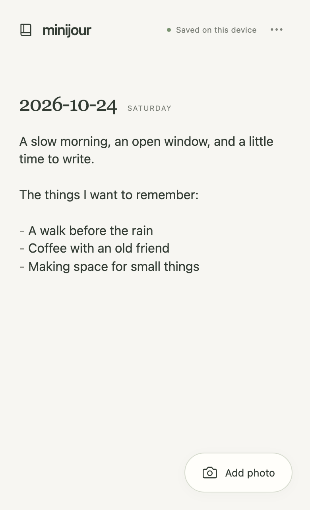

# minijour

A small journal: open it, write Markdown, add a photo. Each new day appears below the last.

minijour is an installable, offline-capable web app. It saves on your device first. Optional encrypted Dropbox sync combines edits across devices with [Automerge](https://automerge.org/). Each person connects their own Dropbox account. No minijour account or application server is required.



## What it does

- Installed apps launch straight into the journal; the website home page explains the app.
- Opens at today's date, ready to write. Changes save automatically.
- Lets you take or choose a photo and insert it at the cursor.
- Displays one chronological page and exports one Markdown file with its photos.
- Works offline after installation, with optional Dropbox sync when online.
- Offers explicit cleanup of unused photos; removing a Markdown link alone preserves the image for undo.

**Early development:** automated tests cover Chromium, including a mobile viewport. Real-device camera, keyboard, installation, and Dropbox sign-in still need verification. See [browser support and known limits](docs/user-guide.md#browser-support).

## Try it locally

Use Node.js 20.19+ within 20.x, or Node.js 22.12+.

```sh
npm ci
npm run dev
```

For installation and offline testing, run `npm run build` followed by `npm run preview`. The development server does not install a service worker.

## Your data

The journal lives in your browser's local database and, if connected, your personal Dropbox app folder. Without Dropbox or an exported backup, clearing browser data or losing the device loses the journal.

No analytics or third-party fonts are included. Dropbox tokens stay on your device and are excluded from backups. Cloud text, editing history, photos, and filenames are encrypted on your device using your cloud password. The local database and downloaded ZIP backups are unencrypted. [Read about storage, privacy, and backups](docs/user-guide.md#storage-and-privacy).

## Documentation

- [User guide](docs/user-guide.md): installation, writing, sync, and backups.
- [Developer guide](docs/development.md): setup, architecture, tests, and a beginner learning path.
- [Deployment guide](docs/deployment.md): static hosting, GitHub Pages, and Dropbox configuration.
- [Release guide](docs/releasing.md): versioning, compatibility, and publication.
- [Changelog](CHANGELOG.md): changes intended for users and deployment operators.

Contributions are welcome. Start with the developer guide. For bugs, include your browser, app version, and steps to reproduce; keep personal content and credentials out of public reports.

## License

Copyright © 2026 folinimarc and contributors. Licensed under the [GNU General Public License v3.0 only](LICENSE), without warranty. Dependency licenses remain applicable. This license applies to the application; your journal entries and photos remain yours.
